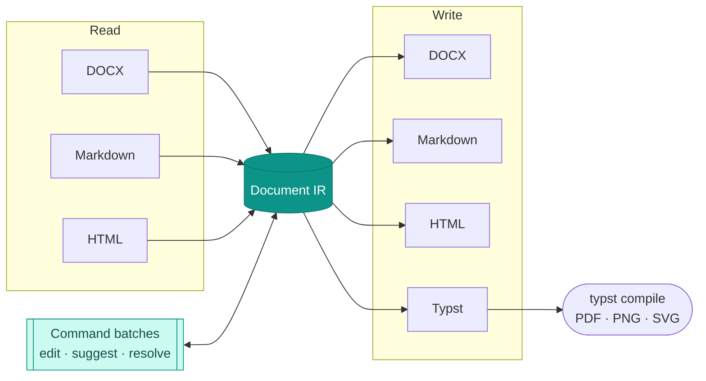
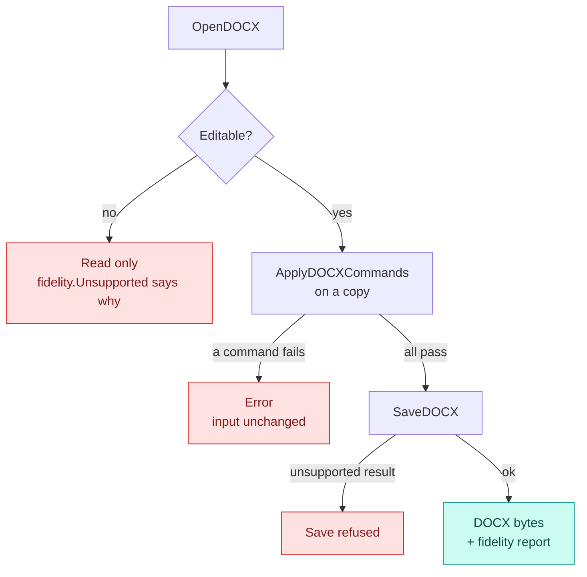

<p align="center">
  <picture>
    <source media="(prefers-color-scheme: dark)" srcset="docs/assets/logo-dark.svg">
    
  </picture>
</p>

<p align="center">
  An open document engine in Go. Parse, edit, and export standard document formats without binding your application to one editor.
</p>

<p align="center">
  <a href="https://github.com/lean-docs/lean/actions/workflows/ci.yml"></a>
  <a href="https://pkg.go.dev/github.com/lean-docs/lean"></a>
  <a href="https://github.com/lean-docs/lean/releases"></a>
  <a href="LICENSE"></a>
</p>

Lean reads documents into one typed model, the **Document IR**, and writes them back out. Every DOCX it opens comes with a **fidelity report**: if the file contains something Lean cannot save without loss, the document stays read only instead of being silently changed.

## What it does



| Format | Read | Write | Notes |
| --- | :---: | :---: | --- |
| DOCX | ✓ | ✓ | Editable profile with fidelity reports and atomic command batches |
| Markdown | ✓ | ✓ | CommonMark 0.31.2 and GFM; native source files keep their exact bytes |
| HTML | ✓ | ✓ | Markdown previews are sanitized |
| Typst | | ✓ | Compile with the Typst CLI for PDF, PNG, and SVG |
| ODT, EPUB, plain text | | | Planned |

## Install

```bash
go get github.com/lean-docs/lean@v0.1.0-alpha.2
```

Document editing and the `lean docx` command line arrive in `v0.1.0-alpha.3`. Until that release is tagged, use `@main` to try them.

## Edit a DOCX

Open the file, check that it is editable, apply a batch of commands, and save:

```go
input, err := os.ReadFile("report.docx")
if err != nil {
	log.Fatal(err)
}

document, fidelity, err := lean.OpenDOCX(input)
if err != nil {
	log.Fatal(err)
}
if !fidelity.Editable {
	log.Fatalf("read only: %v", fidelity.Unsupported)
}

first := document.Sections[0].Blocks[0].BlockID()
edited, err := lean.ApplyDOCXCommands(document, []lean.DocumentCommand{
	{ID: "paragraph.style", Block: first, Style: "Title"},
	{ID: "paragraph.insert", At: 1, Text: "First action"},
})
if err != nil {
	log.Fatal(err) // the input document is unchanged
}

output, _, err := lean.SaveDOCX(edited)
```

A batch runs on a copy of the document. If any command is rejected, nothing is applied:



Commands cover text and formatting, paragraphs, named styles, lists, tables, page layout, sections, headers and footers, footnotes, bookmarks, drawings, watermarks, and tracked changes. `lean.DOCXCommands()` lists every command with the capabilities it needs, and `lean.DOCXCommandSchema(id)` returns its parameter schema.

## Command line

```sh
go install github.com/lean-docs/lean/cmd/lean@main

lean docx commands                                  # list commands as JSON
lean docx inspect input.docx                        # document and fidelity report
lean docx apply input.docx commands.json out.docx   # apply a batch, write a new file
```

`commands.json` holds one JSON array of commands. The output file must not already exist.

## Native Markdown

`OpenMarkdownSource` opens a UTF-8 Markdown file without converting it. `Bytes` returns the original file exactly, including byte order mark, line endings, frontmatter, comments, reference links, and syntax Lean does not model.

| Method | Output | Safe to display? |
| --- | --- | --- |
| `RenderHTML()` | CommonMark with tables, task lists, strikethrough, and autolinks | Yes. Scripts, inline styles, and dangerous links are removed |
| `RenderSyntaxHTML(CommonMark)` | Spec output for conversion and conformance | No. Sanitize before display |
| `RenderSyntaxHTML(GitHubFlavoredMarkdown)` | CommonMark plus the five GFM 0.29 extensions | No. Sanitize before display |

Applications still need to isolate previews and control external resources and navigation. The Markdown parser and exporter are conversion APIs; their normalized output is not a lossless save of the original file.

## Guides

- [Document editing](docs/document-editing.md): commands, positions, and the CLI
- [Tracked changes](docs/tracked-changes.md): suggestions, accept and reject, table styles, and watermarks
- [Explicit run formatting](docs/formatting-overrides.md): on, off, and inherited formatting
- [Architecture](ARCHITECTURE.md): the document model and design decisions
- [Requirements](SRS.md): requirements and test specification
- [Benchmarks](BENCHMARKS.md)

## Project layout

```
lean/
├── cmd/lean/          CLI
├── pkg/
│   ├── ir/            Document IR and JSON serialization
│   ├── parser/        DOCX (OOXML), Markdown, and HTML readers
│   ├── export/        DOCX (OOXML), Markdown, HTML, and Typst writers
│   ├── numbering/     List numbering and markers
│   ├── units/         Measurement conversion
│   ├── layout/        Page layout (not implemented yet)
│   └── font/ hittest/ render/ selection/ wasm/   Reserved for layout and rendering
├── docs/              Guides, release notes, and assets
└── testdata/          Fixtures, golden files, and reference documents
```

## Build and test

```bash
git clone https://github.com/lean-docs/lean.git
cd lean
go build ./...
go test -race -count=1 ./...
```

The Typst export tests compile their output, so they need the `typst` binary on your `PATH`.

## Status

Lean is alpha software. The public API and fidelity guarantees can change before v1.0. Documents outside the editable profile stay read only, and the fidelity report names what each one contains. Each guide lists its own limitations.

See the [changelog](CHANGELOG.md) for what each version adds, [release notes](docs/releases) for each release, and [RELEASING.md](RELEASING.md) for the release process.

## License

MIT. See [THIRD_PARTY_NOTICES.md](THIRD_PARTY_NOTICES.md) for the licenses covering imported conformance fixtures.
